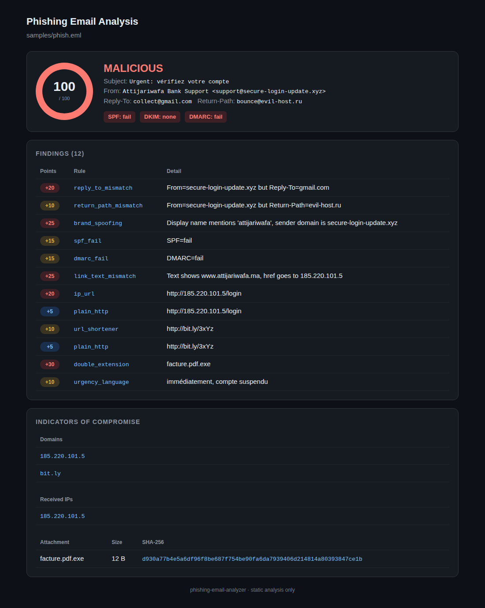
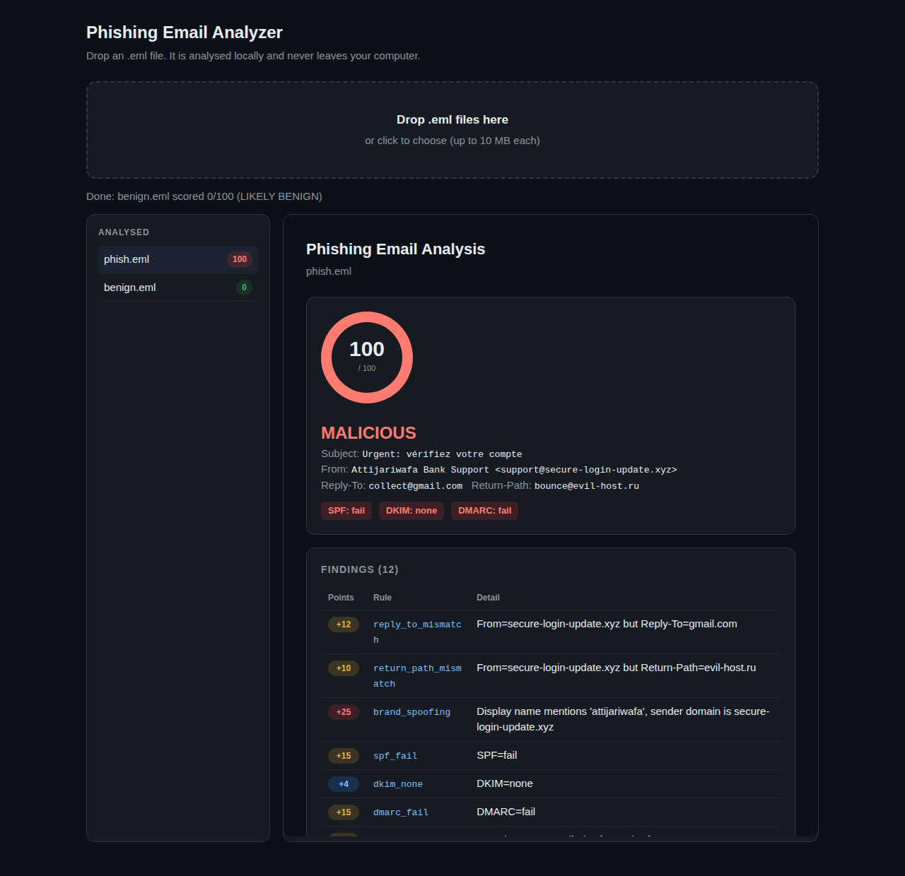

# phishing-email-analyzer



Static analysis of `.eml` files: header forensics, URL and attachment checks, risk score, IOC extraction. Python stdlib only.

## Usage
```bash
python analyzer.py samples/phish.eml          # human-readable report
python analyzer.py samples/phish.eml --json   # machine-readable (exit code 2 if MALICIOUS)
python analyzer.py samples/phish.eml --html report.html   # dark HTML report
python webapp.py                              # local web UI at http://127.0.0.1:8000
python -m unittest discover -s tests -v       # tests
```

## Web interface
`python webapp.py` starts a local site where you drag and drop `.eml` files and get the report in the browser. It uses only the Python standard library, listens on `127.0.0.1` only, and deletes each uploaded file right after the analysis.



## Detection rules
| Area | Rules |
|---|---|
| Headers | Reply-To / Return-Path mismatch, display-name spoofing (brands, embedded email), SPF/DKIM/DMARC fail or none |
| URLs | link text vs href mismatch, IP-based URL, shorteners, punycode, many subdomains, plain HTTP |
| Attachments | dangerous extensions, double extension (`.pdf.exe`), SHA-256 hashes |
| Content | urgency language (FR/EN/PT/ES/AR), spam keywords |

Score 0-100: >=40 MALICIOUS, >=20 SUSPICIOUS, else LIKELY BENIGN. Each rule counts once per email.

## Evaluation on real emails
**Data:** phishing = [phishing_pot](https://github.com/rf-peixoto/phishing_pot) (12,278 real honeypot samples). Legitimate = 300 emails from my own Gmail (Promotions, Updates, Social categories), kept private and not published.

**Method:** a random set of 1,500 phishing + 150 legitimate emails was used to tune the rules. A separate set of 1,500 + 150, never used for tuning, was run **once** for the final result. Alert threshold (score >= 20) was chosen on the tuning set.

| Stage | Phishing detected | Legitimate flagged |
|---|---|---|
| First full test (tuning set, threshold 30) | 69.8% | 24.7% (37/150) |
| After tuning (tuning set, threshold 20) | 69.4% | 2.7% (4/150) |
| **Final (separate test set, threshold 20)** | **66.8%** (1,002/1,500) | **0.7%** (1/150) |

**What tuning changed:** the first test showed that two of my rules fired on most legitimate newsletters (`hidden_text` on 89%, `return_path_mismatch` on 79%) and that per-link findings added up to a score of 100. I dropped `hidden_text`, made each rule count once per email, and counted a Return-Path mismatch only when DMARC did not pass.

```bash
python evaluate.py --phish data/test --ham data/ham_test --sweep
```

**Limits:**
- Only 150 legitimate emails per set. 1 false alarm in 150 means the true rate could be roughly 0.1% to 3.7%.
- The legitimate emails are automated mail (promotions, updates, social) from one mailbox. No personal or work mail.
- About one third of the phishing is missed: many are plain-text or image-only scams with no technical red flag. Next step: URL and IP reputation lookups.
- Precision is not reported because the test set has 10x more phishing than legitimate mail, unlike a real inbox.
- Static analysis only. Nothing is opened or executed.

## Roadmap
- [ ] VirusTotal / AbuseIPDB enrichment (hash, IP, domain)
- [ ] MITRE ATT&CK mapping (T1566.001 / .002)
- [ ] Batch mode on a folder + CSV export
- [ ] Hand-off to IR playbook (TheHive / Shuffle)
